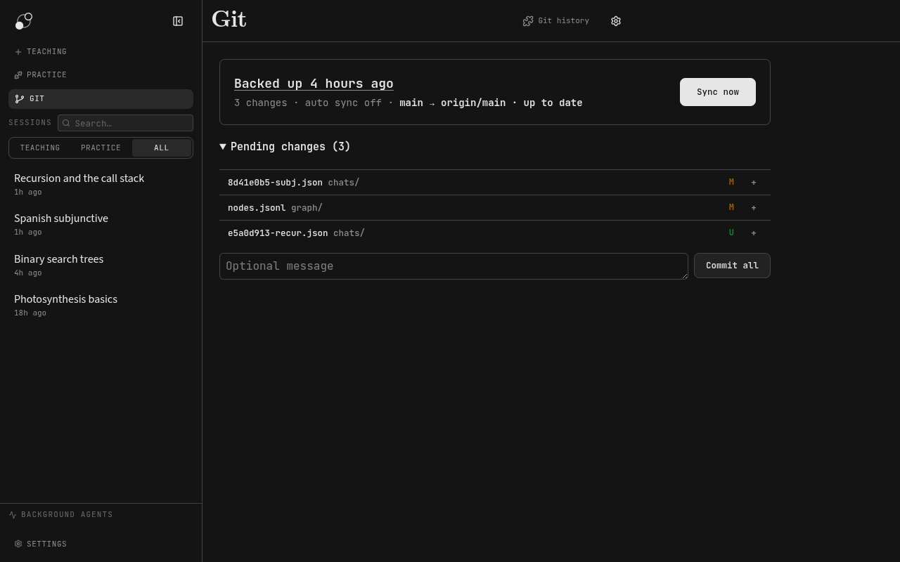
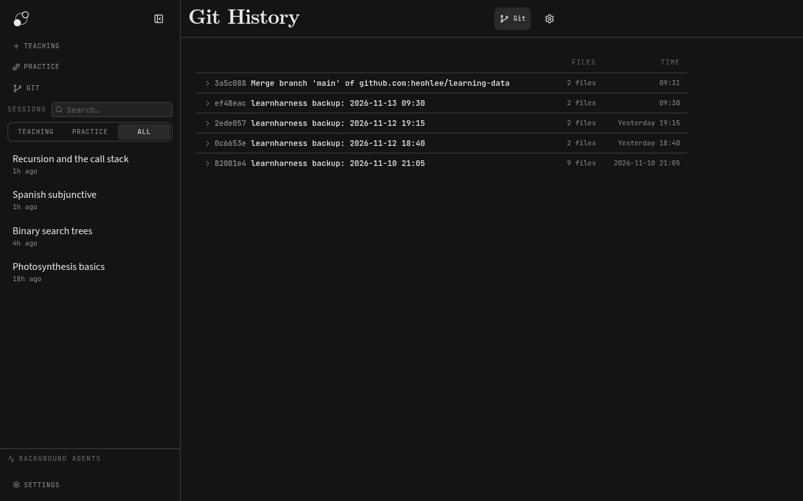
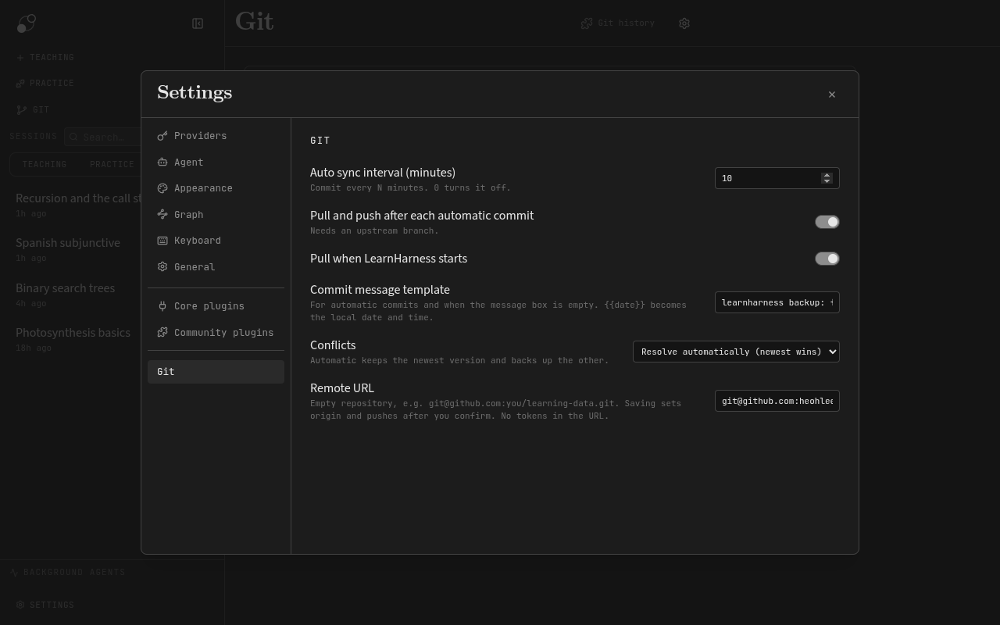

<div align="center">

# LearnHarness Git

Back up and sync your [LearnHarness](https://github.com/amosblomqvist/learnharness) learning data with Git: sessions, knowledge graph, flashcards and settings.

[](https://github.com/heohlee/learnharness-git/actions/workflows/ci.yml)
[](https://github.com/heohlee/learnharness-git/actions/workflows/security.yml)

</div>

A [LearnHarness](https://github.com/amosblomqvist/learnharness) community plugin, inspired by obsidian-git. It turns the learning data folder into a Git
repository and keeps it backed up on a remote you own: commit, pull and push on a schedule or with one
button. It uses the `git` installed on your computer, with your own SSH keys or credential helper, and it
handles merge conflicts without ever leaving broken JSON in your learning records.

## Features

- **Git view**: backup status, Sync now and pending changes (stage, unstage, diff, commit). Click "Backed up …" to open Git History.

<p align="center">

</p>

- **Git History**: every commit with its hash, file count and time, expandable to its files. Shows the author only if it isn't you.

<p align="center">

</p>

- **Automatic sync**: commit, pull and push every N minutes; pull on startup.
- **Connect a remote**: set the URL in Settings; before the first push, flags files that may hold secrets, including in the history.
- **Second computer**: clone an existing backup; replaced local files go to `.learnharness-git-backup/`.
- **Merge conflicts**: resolved automatically (newest wins, the other is backed up) or per file (Local / Remote, with diff).
- **Valid JSON only**: invalid JSON is never committed.
- **Safe with your Git work**: never touches a merge, rebase, cherry-pick or revert you started.
- **Clear auth errors**: suggests `gh auth setup-git` or an SSH URL.
- **Keyboard actions**: commit, sync, pull and push.

## Requirements

- LearnHarness 0.6.1 or newer (desktop app).
- `git` 2.31 or newer on the `PATH`.
- For a remote: SSH keys, or HTTPS with a credential helper (for GitHub: `gh auth login && gh auth setup-git`). The plugin never asks for a password.
- Install paths 2 and 3 also need Node.js 24 or newer and npm.

## Install

Find the plugins folder in **Settings → Community plugins** (by default on Linux:
`~/.config/LearnHarness/data/plugins`).

### 1. Prebuilt package (recommended)

Download `learnharness-git-<version>.zip` from the [releases](https://github.com/heohlee/learnharness-git/releases).
It already contains the `learnharness-git/` folder: extract it directly into the plugins folder, so that
`<plugins folder>/learnharness-git/dist/manifest.json` exists.

To update: replace only `learnharness-git/dist/` with the new one (keep `learnharness-git/data/`, which holds
the plugin settings), then restart LearnHarness.

### 2. From source, inside the plugins folder

```sh
git clone https://github.com/heohlee/learnharness-git.git "<plugins folder>/learnharness-git"
cd "<plugins folder>/learnharness-git"
npm ci
npm run build
```

To update: `git pull && npm ci && npm run build`, then restart LearnHarness.

The clone has its own `.git`, so the plugin keeps `plugins/learnharness-git/` out of your backup (in
`.git/info/exclude`, on this computer only), and its settings in `data/` are not backed up. The same applies to any
plugin installed with `git clone`. If v0.1.0 already committed the folder, remove it from the backup once with
`git rm --cached plugins/learnharness-git` in the learning data folder, then commit.

### 3. From a separate checkout (development)

```sh
git clone https://github.com/heohlee/learnharness-git.git
cd learnharness-git
npm ci
npm run install:local -- "<plugins folder>"
```

`install:local` builds and replaces only the installed `dist/`. Restart LearnHarness to load code changes.

### Turn it on

**Settings → Community plugins → Refresh plugins**, then turn on **Enable Git**. **Git** appears in the sidebar.

## Usage

1. Open **Git** in the sidebar.
2. First computer: press **Initialize repository**. Second computer: press **Clone from remote** and paste the backup URL, then restart LearnHarness.
3. In **Settings → Git → Remote URL**, paste the URL of an empty private repository (for example `git@github.com:you/learning-data.git`) and confirm **Connect and push**.
4. Press **Sync now**, or set **Auto sync interval** and turn on **Pull and push after each automatic commit**.

**Initialize repository** adds a `.gitignore` and a `.gitattributes` for the learning data if they don't exist.
Existing ones are never changed. The `.gitattributes` makes graph ledgers changed on two computers merge
instead of conflicting.

<details>
<summary>What they contain</summary>

```gitignore
# Automatic graph copies: Git already keeps every version of graph/.
graph-backup-*/
# Usage log of the built-in plugins: nothing reads it.
core-plugin-data/*/usage.jsonl
# Community plugin code; keep only each plugin's data/ (its settings).
plugins/*/*
!plugins/*/data/
# Graph layout: rewritten whenever the graph is opened, and recomputed if missing.
graph/positions.json
```

```gitattributes
graph/*.jsonl merge=union
```

</details>

## Configuration

**Settings → Git**:

<p align="center">

</p>

| Setting                                   | Default                             | Description                                                                      |
| ----------------------------------------- | ----------------------------------- | -------------------------------------------------------------------------------- |
| Auto sync interval (minutes)              | `0`                                 | Commit every N minutes; `0` turns it off.                                        |
| Pull and push after each automatic commit | off                                 | Needs an upstream branch.                                                        |
| Pull when LearnHarness starts             | off                                 | Pull once at startup.                                                            |
| Commit message template                   | `learnharness backup: {{date}}`     | For automatic commits and when the message box is empty.                         |
| Conflicts                                 | Resolve automatically (newest wins) | Or **Ask me** to pick Local / Remote for every conflicted file.                  |
| Remote URL                                | (none)                              | `origin`; saving it pushes after you confirm. No passwords or tokens in the URL. |

## Privacy

The plugin runs Git on your learning data folder only. Everything in that folder that your `.gitignore` does
not exclude (sessions, the knowledge graph, flashcards, settings) is committed and pushed to the remote you
choose: use a private repository. Provider API keys live outside that folder and are never read or pushed.
The plugin stores only its own settings, in `learnharness-git/data/settings.json` next to its code. It
contacts no service other than your Git remote.

## Development

```sh
npm ci
npm run coverage   # tests with an 85% line, branch and function minimum
npm run typecheck
npm run lint
npm run package    # releases/learnharness-git-<version>.zip, the prebuilt package
```

## License

[AGPL-3.0](LICENSE)
